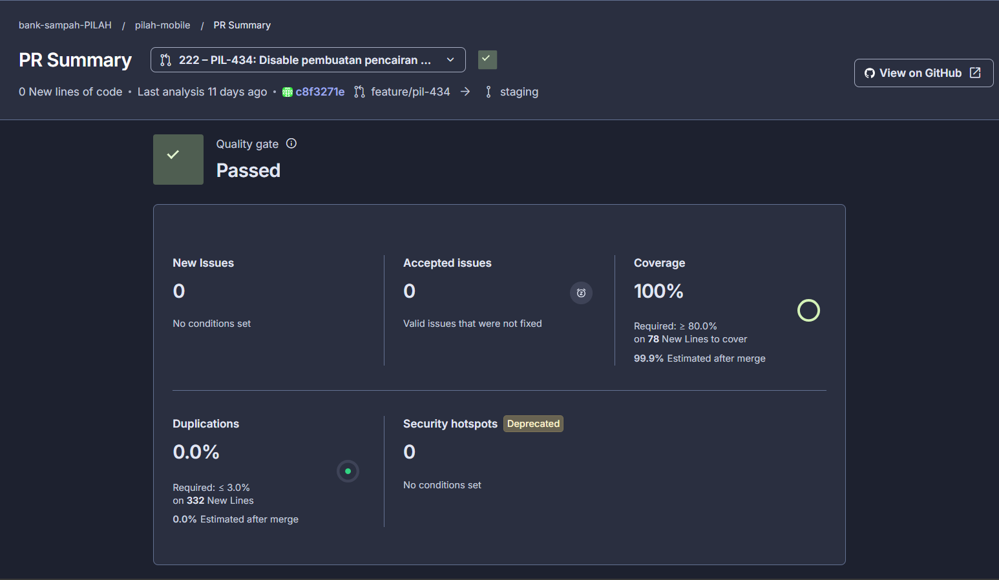
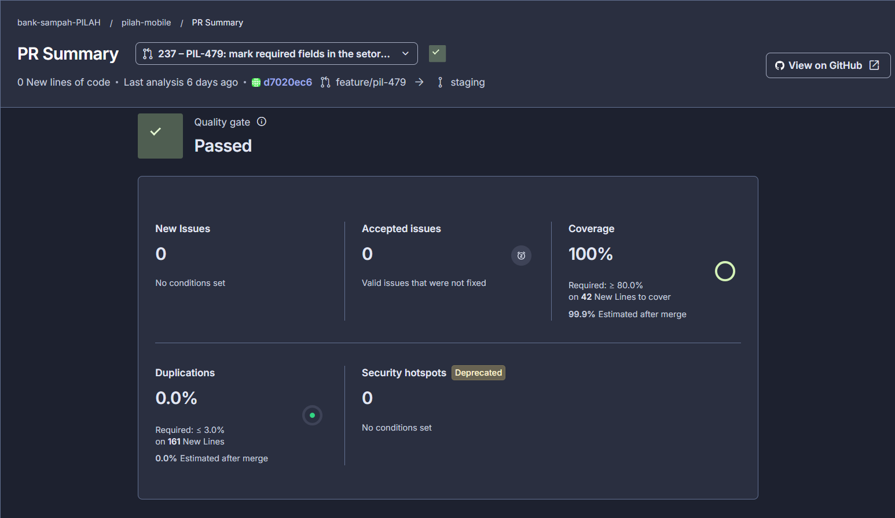
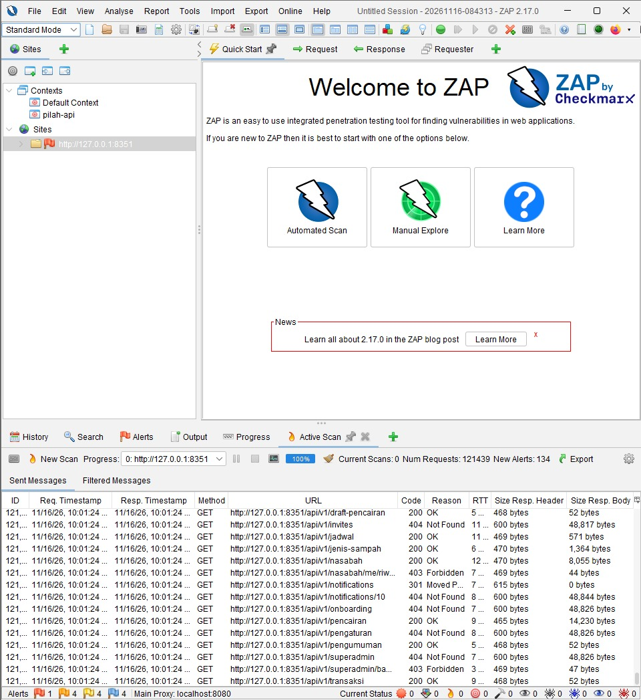

# Sprint 3 · Week 2

**3 to 9 November 2026** · mobile · PIL-434 and PIL-479, two pull requests that
both turned out to be about telling the truth on screen

Two tickets ran in this week. PIL-434 disables the creation of a new pencairan
for the handover build, and the dead menus everyone could see turned out to be
the smaller half of it. PIL-479 marks the required fields in the setoran forms,
and the marker then had to be made honest, because a starred field that still
would not save is a worse lie than no star at all.

| Unit | State | What it does |
|---|---|---|
| PIL-434 | [mobile #222](https://github.com/bank-sampah-PILAH/pilah-mobile/pull/222), **merged** 5 Nov, raised 4 Nov | Removes the Pencairan entry points and locks the three creation routes behind them |
| PIL-479 | [mobile #237](https://github.com/bank-sampah-PILAH/pilah-mobile/pull/237), **merged** 11 Nov, raised 9 Nov | Marks the required captions in Transaksi Baru and Edit Setoran, and explains the save lock the marker does not cover |

!!! note "What this page claims, and where its boundaries are"
    **All seven: B1 to B7.** B1, B2 and B3 are reported **per pull request**,
    because the two differ in kind: one closes a feature and one changes what a
    form says about itself.

    **PIL-479 was raised on 9 November and merged on 11 November**, so its
    merge falls in the next window. Every commit, the whole review round and
    the final numbers are from 9 November, and the figures quoted here are the
    post-merge ones, so nothing about it can move later. It is reported here
    and not on Sprint 3 Week 3.

    **PIL-478 was also opened on 9 November** and is reported on
    [Sprint 3 · Week 3](s3-w3.md), where it merged. Nothing from it is claimed
    on this page.

    The four reviews under [B4](#b4-team-development-management) were posted on
    3 and 9 November. The two reviews claimed on
    [Sprint 3 · Week 1](s3-w1.md#b4-team-development-management) were posted on
    2 November and are not re-claimed here.

## B1 · Test-driven development

Twenty-eight commits across two pull requests, and the cycle is in the history
rather than described after the fact: every `test(...)` or `[RED]` commit was
run and seen failing before the commit that makes it pass.

=== "mobile 222, PIL-434, the feature lock"

    Thirteen commits, in a shape worth reusing: **four behaviour-neutral
    refactors first, each with its own diff, then three red to green cycles,
    then three review fixes.**

    | | Commit | Phase |
    |---|---|---|
    | 1 | [`43a1dfe4`](https://github.com/bank-sampah-PILAH/pilah-mobile/commit/43a1dfe4) `refactor(router)`: name the feature lock instead of retyping its redirect | refactor |
    | 2 | [`38e1b28e`](https://github.com/bank-sampah-PILAH/pilah-mobile/commit/38e1b28e) `refactor(draft-pencairan)`: keep the creation routes with the feature | refactor |
    | 3 | [`ce827d10`](https://github.com/bank-sampah-PILAH/pilah-mobile/commit/ce827d10) `refactor(dashboard)`: configure the Transaksi chooser instead of hardcoding it | refactor |
    | 4 | [`d0bb1097`](https://github.com/bank-sampah-PILAH/pilah-mobile/commit/d0bb1097) `test(nav)`: the Transaksi menu offers no Pencairan | red |
    | 5 | [`eec6c665`](https://github.com/bank-sampah-PILAH/pilah-mobile/commit/eec6c665) `feat(nav)`: remove Pencairan from the Transaksi menu | green |
    | 6 | [`170966c7`](https://github.com/bank-sampah-PILAH/pilah-mobile/commit/170966c7) `refactor(dashboard)`: let the caller say which transactions are open | refactor |
    | 7 | [`691dd4c8`](https://github.com/bank-sampah-PILAH/pilah-mobile/commit/691dd4c8) `test(dashboard)`: Transaksi Baru records a setoran directly | red |
    | 8 | [`89c4670a`](https://github.com/bank-sampah-PILAH/pilah-mobile/commit/89c4670a) `feat(dashboard)`: Transaksi Baru records a setoran directly | green |
    | 9 | [`0b49ccd8`](https://github.com/bank-sampah-PILAH/pilah-mobile/commit/0b49ccd8) `test(draft-pencairan)`: the creation flow is unreachable | red |
    | 10 | [`bb46d83e`](https://github.com/bank-sampah-PILAH/pilah-mobile/commit/bb46d83e) `feat(router)`: lock the pencairan creation routes | green |
    | 11 | [`218db103`](https://github.com/bank-sampah-PILAH/pilah-mobile/commit/218db103) `fix(router)`: a locked route keeps its name | fix, from review |
    | 12 | [`4f891963`](https://github.com/bank-sampah-PILAH/pilah-mobile/commit/4f891963) `fix(dashboard)`: nothing open means no Transaksi Baru | fix, from review |
    | 13 | [`c8f3271e`](https://github.com/bank-sampah-PILAH/pilah-mobile/commit/c8f3271e) `fix(main)`: the collapsed shortcut names its group too | fix, from review |

    **Twelve cases across the three red commits, and each red commit names its
    own positive, negative and corner case in its body** rather than leaving a
    reader to classify them:

    | Kind | Case | What it pins |
    |---|---|---|
    | Positive | *the wide rail keeps Transaksi, Riwayat and Setoran, and Setoran still fires* | What is left, not only what went. |
    | Positive | *every pengurus with nothing but setoran open gets the form on the first tap* | The chooser collapses rather than offering a list of one. |
    | Negative | *the drawer draws no Pencairan row, by label, icon and key* | Three finders, because one of them passing is not enough. |
    | Negative | *no row in the accordion is inert* | Asserted over **every** `RoleMenuRow` rather than by naming Pencairan, so a future dead row fails this test too. |
    | Negative | *every `/draft-pencairan` URL lands on the dashboard, and shows no page and no "page not found"* | Both halves of the ticket at once: the flow is gone and no error is visible. |
    | Corner | *the collapsed rail opens Setoran on the first tap and draws no `PopupMenuButton` at all* | The one window where the menu was a popup rather than an accordion. |
    | Corner | *the collapsed shortcut still turns green while Setoran is open* | The selected state has to survive losing the menu it used to be read from. |
    | Corner | *a saved draft named by `?id=` plus extra does not reopen the editor* | The lock sits in front of the route guard rather than behind it. This is the case a refreshed web tab used to restore. |
    | Corner | *the editor with no draft does not bounce through the locked draft list* | One redirect, not a chain through a locked path, which is the redirect loop this could have become. |

    **The finding that made the ticket bigger than it looked.** The dead
    controls were real, but all three creation routes were **still registered
    with their builders**, so on the web `/draft-pencairan`,
    `/draft-pencairan/pilih` and `/draft-pencairan/editor` opened the whole
    draft, pilih nasabah, editor, konfirmasi flow to anyone who typed the URL
    or held a bookmark. The ticket's first acceptance criterion was not met at
    all before this pull request. The navigation had been cut two weeks
    earlier and the routes left behind, which is exactly the shape a menu
    cleanup hides.

    **Two traps this commit shape avoided, both about coverage:**

    - A `switch` arm for a closed feature is **a line coverage can never
      reach.** The first attempt had `case pencairan: break;`. It was fixed by
      making the arm real and reachable from a test through the injected set,
      so the closed state is a configuration rather than a dead branch.
    - **A red that fails to compile is weak evidence.** The first dashboard red
      failed on `Undefined name`, which proves nothing about behaviour.
      Refactor 6 was inserted first so that the red failed on the real thing:
      the chooser still intercepting the tap.

    Coverage of the changed code is **100% of lines in all six changed library
    files**, counted per file rather than as an average: `locked_routes.dart`
    4/4, `app_router_config.dart` 181/181, `dashboard_action_buttons.dart`
    27/27, `transaksi_chooser_sheet.dart` 44/44,
    `draft_pencairan_routes.dart` 10/10, `role_transaction_menu.dart` 79/79.

    **SonarCloud: 0 new issues, 0 accepted issues, 0 security hotspots, 100.0%
    coverage on new code, 0.0% duplication**, read off the analysis rather than
    off the badge, and still 0 and 100.0% after the three review fixes.

=== "mobile 237, PIL-479, the required markers"

    Fifteen commits: **five red to green slices, one behaviour each**, then the
    documentation, then a review round that added three more tests and one
    refactor.

    | | Commit | Phase |
    |---|---|---|
    | 1 | [`58082051`](https://github.com/bank-sampah-PILAH/pilah-mobile/commit/58082051) `test(design)`: a required field marker | red |
    | 2 | [`94ec6443`](https://github.com/bank-sampah-PILAH/pilah-mobile/commit/94ec6443) `fix(design)`: mark a required field caption with an asterisk | green |
    | 3 | [`03296d0a`](https://github.com/bank-sampah-PILAH/pilah-mobile/commit/03296d0a) `test(design)`: the required marker colour | red |
    | 4 | [`f92eb4de`](https://github.com/bank-sampah-PILAH/pilah-mobile/commit/f92eb4de) `fix(design)`: draw the required marker in the danger red | green |
    | 5 | [`e3642840`](https://github.com/bank-sampah-PILAH/pilah-mobile/commit/e3642840) `test(design)`: the required field semantics | red |
    | 6 | [`c3724ee2`](https://github.com/bank-sampah-PILAH/pilah-mobile/commit/c3724ee2) `fix(design)`: read a required caption as wajib diisi | green |
    | 7 | [`84ad8354`](https://github.com/bank-sampah-PILAH/pilah-mobile/commit/84ad8354) `test(transaksi)`: the required alasan caption | red |
    | 8 | [`cbf9117e`](https://github.com/bank-sampah-PILAH/pilah-mobile/commit/cbf9117e) `fix(transaksi)`: mark alasan perubahan as a required field | green |
    | 9 | [`8afdb119`](https://github.com/bank-sampah-PILAH/pilah-mobile/commit/8afdb119) `test(transaksi)`: required captions in the setoran form | red |
    | 10 | [`332163ac`](https://github.com/bank-sampah-PILAH/pilah-mobile/commit/332163ac) `fix(transaksi)`: mark the nasabah and item list captions as required | green |
    | 11 | [`955d3d5b`](https://github.com/bank-sampah-PILAH/pilah-mobile/commit/955d3d5b) `docs(design)`: document the required field marker | docs |
    | 12 | [`711ac5d9`](https://github.com/bank-sampah-PILAH/pilah-mobile/commit/711ac5d9) `style(transaksi)`: apply dart format to the touched files | housekeeping |
    | 13 | [`ea3b48b8`](https://github.com/bank-sampah-PILAH/pilah-mobile/commit/ea3b48b8) `fix(transaksi)`: explain a disabled Simpan Perubahan in edit setoran | fix, from review |
    | 14 | [`18633c1c`](https://github.com/bank-sampah-PILAH/pilah-mobile/commit/18633c1c) `docs(design)`: widen the required marker rule to a list of inputs | docs, from review |
    | 15 | [`d7020ec6`](https://github.com/bank-sampah-PILAH/pilah-mobile/commit/d7020ec6) `refactor(transaksi)`: one item-problem rule via Template Method | refactor, from review |

    **Positive, negative, corner**, by the names the cases carry:

    | Kind | Case | What it pins |
    |---|---|---|
    | Positive | *marks a required field with an asterisk* | The behaviour the ticket asks for, at the design-kit level. |
    | Positive | *marks the customer and the item list as required fields* | The same thing where a pengurus meets it, in Transaksi Baru. |
    | Negative | *leaves a field unmarked unless it is required* | The default. This is the case that protects 38 existing call sites. |
    | Negative | *marks the alasan as required and leaves the catatan optional* | The two fields sit next to each other and read the same, which is the whole reported defect. A test that only checked the star would have passed on a form that starred both. |
    | Corner | *draws the required marker in the danger red at caption size* | Colour and size together, because a marker at body size in the right colour still looks like a typo. |
    | Corner | *is read by a screen reader as wajib diisi when required* | A bare asterisk is announced as "asterisk". The visible and the audible form have to say the same thing. |
    | Corner | *says a change is still needed, and stops once one is made* | From review. The star is true and the button is still dead, so the case asserts the explanation appears at exactly the moment the star stops explaining enough, and goes away on the first edit. |
    | Corner | *a fresh item asks for its jenis instead of just dying* | From review. A seeded item card has no jenis, and the only message spoke about berat. |

    **The default render is byte-identical, and that is a tested decision.**
    Thirty-eight call sites and 77 existing tests locate captions with
    `find.text('SOME CAPTION')`, which only matches a plain `Text`'s `data`.
    The marker is therefore a `Row` sibling rather than an appended string or a
    `Text.rich` span. The regression that choice protects is pinned by a
    neighbour suite rather than asserted in prose: `setoran_side_sheet_test.dart`
    looks up `find.text('PILIH NASABAH')` and still passes, 12 of 12.

    **The review round is where this pull request earned its B1.** Three of the
    four findings were the same defect wearing different hats: the asterisk
    said "this field is required" while something else was holding the button
    down, so a pengurus fills the starred field and nothing happens. Each
    finding got its own test, and the third exposed a duplicated rule that is
    dealt with in [B2](#b2-programming-principles).

    **SonarCloud: 0 new issues, 0 accepted, 0 security hotspots, 100.0%
    coverage on new code, 0.0% duplication.**

### What the two share

The convention is the same in both, and it is the only reason a claim to
practise TDD can be checked: **the test and the implementation are never in the
same commit**, one behaviour per cycle, and commit bodies record the commands
actually run with their output rather than a summary. Both pull requests also
quote the full-suite result honestly, including the two `test/features/profile`
failures that are Windows-only, present on untouched `staging`, and verified as
such by reverting the changed library files and re-running those two files
alone.

!!! warning "No coverage screenshot on either, and B1 asks for one"
    Coverage is on record three ways for both pull requests: a per-file line
    count in the body, SonarCloud's new-code figure, and CI's own coverage
    gate. What is missing is the HTML coverage report captured as an image,
    which the criterion names explicitly. Every week's page except
    [Sprint 2 · Week 1](s2-w1.md) is missing it, so this is a standing gap
    rather than a new one.

## B2 · Programming principles

Two patterns, one per pull request, each in its own commit so the diff is
linkable. As on the earlier pages, the plain problem comes first and the
pattern name comes last, because the name is the least interesting thing about
it.

### Proxy, in its protection variant

**The practical problem.** Locking a feature for the handover was written out
by hand at every path: a `GoRoute` whose redirect points at the dashboard, with
the reasoning in a comment above one of them. Pengumuman already needed it
twice, and draft pencairan needed three more, at which point the rule lives in
five places and its justification in one.

**What the pattern does.** `lockedRoute` and `lockedRoutes` stand at the real
routes' paths, keep the same interface (`GoRoute`), and control access to them.
The real subject is not deleted: `draftPencairanRoutes` stays compiled and
tested inside the feature, and the router registers
`lockedRoutes(draftPencairanRoutes)` instead of the list itself.

**What it buys, concretely.** The router now says *which feature is locked*
rather than *how a lock is built*. The locked paths are derived from the
feature's own route list, so the redirects cannot drift away from the real
paths, and reopening the feature is a change to one call rather than an
archaeology exercise. The refactor is behaviour-neutral and says so checkably:
71 router and pengumuman route tests passed untouched.

| Considered | Verdict |
|---|---|
| Delete the routes | **Rejected.** The router declares no `errorBuilder`, so a deleted path answers an old bookmark with go_router's "page not found", and the ticket forbids a visible error as firmly as it forbids the page. |
| Guard the pages instead of the paths, rendering an empty state | **Rejected.** That is the empty page the ticket forbids. |
| Leave the lock as a per-path redirect copy, as the previous ticket did | **Rejected** once a second feature needed it. Pengumuman was moved onto the helper in the same commit. |

Arrives in
[`43a1dfe4`](https://github.com/bank-sampah-PILAH/pilah-mobile/commit/43a1dfe4)
and is used in
[`bb46d83e`](https://github.com/bank-sampah-PILAH/pilah-mobile/commit/bb46d83e).

!!! note "Two things in PIL-434 are deliberately not given a pattern name"
    `transaksiPilihanTerbuka` and the extracted `TransaksiChooserSheet` are a
    single source of truth and a widget told what to offer. That is DRY and the
    open-closed principle, and the chooser reappears the moment a second
    transaction type is open, which a test holds down. Calling either one a
    pattern would be padding a count the criterion does not ask to have padded.

### Template Method

**The practical problem.** Transaksi Baru and Edit Setoran check the same
deposit card by the same rule, jenis before berat, because without a jenis the
berat means nothing yet. Each form had written that order and both message
strings out for itself.

**Those copies had already drifted, which is how this was found.** On Edit
Setoran, "Tambah Item" seeds a card with no `jenis_sampah_id`, while the only
message spoke about berat, so Simpan Perubahan went dead with nothing on screen
to explain it. Transaksi Baru was already right. The commit before the refactor
fixed the symptom by adding a *second* copy of the rule, which left two copies
that agreed that day and no mechanism keeping them agreeing next month.

**What the pattern does.** `ItemSetoranProblemReporter.messageFor` holds the
invariant: the order of the checks and the wording of both messages. The
subclasses supply only what genuinely differs between the two forms, which is
how a card is read, and **when** a missing jenis is worth complaining about.

| Form | When it reports | Why that one |
|---|---|---|
| Transaksi Baru | After submit | A new card is born without a jenis, so flagging it earlier scolds a pengelola who has done nothing yet. |
| Edit Setoran | At once | It has no equivalent of "before submit was pressed": the button simply sits dead, so silence means nothing explains it. |

**What it buys, concretely.** The one thing the two forms were ever allowed to
differ about is now a named method with the reasoning attached, instead of an
`if (!_hasSubmitted)` buried mid-function. Behaviour preservation is checkable
rather than asserted: **849 tests across `test/features/transaksi` and
`test/design` pass with no test file touched by that commit.**

| Considered | Verdict |
|---|---|
| A shared free function taking the two booleans plus a flag | **Rejected.** It removes the duplicated strings but not the duplicated decision: each form still has to remember which way round to pass the flag, which is exactly the mistake already made here once. |
| Pushing the rule onto `SetoranDraft` in the domain layer | **Rejected.** Edit Setoran holds raw `Map<String, dynamic>` rows rather than a `SetoranDraft`, so this forces a conversion every frame for the sake of a message, and a UI string does not belong in a domain entity. |
| Letting `ItemSetoranCard` derive its own message | **Rejected.** Tempting, since it already takes `hasError` and `errorText`, but the card does not know about submit state and should not: that is the form's business, and the card is reused where the timing differs. |

Arrives in
[`d7020ec6`](https://github.com/bank-sampah-PILAH/pilah-mobile/commit/d7020ec6).

!!! success "This refactor reopened an approval on purpose, and said so"
    The pull request was already approved when the duplication was found. The
    commit was pushed anyway, with a comment explaining why it was worth a
    second look rather than a follow-up ticket: patching the symptom and
    leaving the shape intact is the condition that produced the defect in the
    first place. The same comment offered to split it onto its own pull request
    off `staging` if the reviewer preferred to keep the approval he had already
    given.

## B3 · Development discipline

| | mobile 222, PIL-434 | mobile 237, PIL-479 |
|---|---|---|
| State | **Merged** 5 Nov | **Merged** 11 Nov |
| Branch | `feature/pil-434` | `feature/pil-479` |
| Base | `staging` | `staging` |
| Commits | 13 | 15 |
| Diff | +696 / −342, 11 files | +294 / −29, 8 files |
| CI | All green | All green |
| SonarCloud | 0 issues, 100.0% new-code coverage | 0 issues, 100.0% new-code coverage |
| Review | 1 review, 5 findings, 3 fixed and 2 answered | 1 review, 4 findings, all 4 taken |

Shared across both: a branch named from the Linear issue, a sibling worktree
rather than the nested submodule checkout, every gate run locally before the
push, and screenshots of the affected viewports in the pull-request body.

=== "Two merge requests, both merged"

    Level 4 asks for **more than** two meaningful merge requests in the week.
    Two were opened and both merged, which is level 3, and it is reported as
    the count rather than as a band.

    PIL-478's two pull requests were also opened on 9 November and would make
    the count four, but they merged on 11 November and are claimed on
    [Sprint 3 · Week 3](s3-w3.md). Counting them here as well would be
    claiming the same work twice.

=== "The gate that is not in the instruction file"

    `dart format --output=none --set-exit-if-changed lib test codegen` is
    enforced by CI and both pull requests run it before pushing. On PIL-479 it
    failed on four touched files, which is what
    [`711ac5d9`](https://github.com/bank-sampah-PILAH/pilah-mobile/commit/711ac5d9)
    is. Worth knowing why that matters more than tidiness: when the format job
    fails, the Sonar analysis never runs, so a formatting miss reads as a
    missing quality report rather than as a formatting error.

    Note also that `--output=none` does not write anything. The file has to be
    formatted for real first, which is a one-line mistake that looks like a
    passing check.

=== "The issue tracker, in both directions"

    PIL-434's Linear issue had **no description**, like its sibling PIL-435.
    One was written before any code, in the same shape used for the previous
    ticket: Konteks, Lingkup, Di luar lingkup, and acceptance criteria. The
    pull request then names its parents explicitly, closing the last open child
    of the handover epic after the Riwayat and Pengumuman tickets.

    PIL-479 came the other way: it is a UAT finding with its own acceptance
    criteria, and the third of them ("isian wajib lain di form setoran
    konsisten") is open to reading. The pull request states the reading it took,
    says which caption it leaves unmarked and why, and invites the reviewer to
    say if the heading was meant too. He did, and the code moved rather than
    the wording.

## B4 · Team development management

**Four reviews given**, on four different people's pull requests across both
repositories, two of which are entirely about performance under real data
volumes. **Two reviews received**, both from Heraldo, with nine findings
between them, and every thread answered in the thread.

Per the standing rule for these pages, review comments are reported by
**content only**: no comment dates and no links to the comments themselves.

### Reviews I gave

=== "backend 165, Tristan, scheduled notifications"

    Jadwal participants get notified, with a two-hour reminder. The review
    opens with what is right, because those were the parts easy to get wrong:
    the state transition became atomic so a queued notification cannot outlive
    a rolled-back status change, a no-op PATCH does not spam members because
    the comparison is on value tuples, the dropped-recipient set is computed
    as a difference rather than from the current members, and the queue drain
    takes `select_for_update(skip_locked=True)` so a second worker is safe.

    **Five findings, three of them about what happens when a bank gets
    popular:**

    1. **The notify loop is an N+1 over recipients, with a savepoint each.**
       `queue_push` opens its own transaction per recipient, which is now
       nested, so each call also costs a savepoint and a release. That is
       roughly five round trips per recipient inside the request that publishes
       the jadwal, so a bank publishing to 200 nasabah does on the order of a
       thousand round trips while a pengurus stands in front of a room. The
       fix offered is a bulk sibling in the same port, with the code written
       out, so callers still never touch the models directly. It collapses to
       three queries. The honest caveat is written in too: the bulk version is
       all or nothing where the loop swallowed one user's failure, which is a
       behaviour change and the author's call.
    2. **The FCM sender re-resolves credentials and builds a new session per
       message**, so draining N messages means N credential resolutions and N
       connection pools, each with a fresh TLS handshake, and no token reuse.
       Hoisting it is the largest win per line in the pull request and also
       makes the function testable without patching the auth library.
    3. **The delivery table has no index for the query that drains it.** The
       only index is a uniqueness constraint that does not serve the predicate,
       and the table is append-only in practice, so the hot query is a scan
       that gets slower every day the app is used. A partial index on the
       pending rows keeps it proportional to the backlog rather than to the
       history.
    4. The notification list endpoint returns the entire history unpaginated,
       on the screen a nasabah opens most often.
    5. The FCM call happens while holding two row locks inside an open
       transaction, for up to ten seconds of someone else's network. This one
       is explicitly **not** asked for in that pull request, only written down
       so the next person knows it was seen.

=== "mobile 242, Ghani, the waste-type picker"

    A searchable jenis sampah picker replaces a dropdown. The review says
    plainly why the approach is right, including a consequence the author may
    not have been counting on: taking the selected value from the item data
    means a jenis deactivated after the fact still shows its recorded name
    instead of silently blanking.

    **Six findings, the first two about per-keystroke cost:**

    1. **The `ValueKey` on the `ListView` throws the list away on every
       keystroke.** The key is built from the query, so each character
       deactivates the entire list subtree and inflates a fresh one: new
       scrollable, new scroll position, every built tile and ink well
       discarded. That is the opposite of what `ListView.builder` exists for.
       The sibling nasabah picker already achieves the intended effect, which
       is sending the list back to the top, by owning a `ScrollController` and
       calling `jumpTo(0)`, so the fix is to copy the neighbour and delete the
       key.
    2. **The whole catalogue is re-derived on every keystroke**, including a
       fresh list allocation, a map, a where, a toSet, a toList, a sort, and a
       `toLowerCase()` per item per keystroke. The suggestion includes the
       derived-state cache written out, and a note that `identical()` on the
       catalogue getter can never help because it returns a new list each
       call. It also says what **not** to do: a debounce would only add latency
       to a filter over data already in memory. Make the per-keystroke work
       cheap instead.
    3. The picker drops the presentation it is handed, so a phone sheet has no
       drag handle and the close button shows in both containers, against two
       documented design-system rules. This matters more than usual because the
       ticket ships to web as well as native, so the dialog path is real.
    4. The category filter is a raw dropdown where the design system has a chip
       for exactly that job, which the harga page already uses for this same
       filter, and which brings the 48 dp hit area and the selected state a
       screen reader reads.
    5. Search matches only the name while the entity carries the waste code,
       which is what a pengurus who works the price list daily is likely to
       type.
    6. The sibling picker reports search analytics and this one does not, so
       the funnel that would answer "is the search actually used" is missing
       the only question the ticket implicitly asks.

    The findings are ordered by what they buy, and the review ends by saying
    which three would block a merge and which three are fine as a follow-up if
    the sprint is tight.

=== "mobile 211 and 209, Pascal, the side sheet and the WhatsApp step"

    Both are follow-ups to my own PIL-432 work, which makes them easy to rubber
    stamp, so both reviews went looking for one specific defect class:
    **async lifetime**, the bug that bit the harga panel, the jadwal panel and
    the side sheet itself.

    On **211** the fix held. The pop guard covers the two `maybePop` doors and
    the header close button, and the browser-back door through the route's
    exit hook. Reading the busy flag through the form's state on each attempt
    rather than caching it is the right call for the same reason the unsaved
    check is read that way, and a test pins that it is read again rather than
    cached. The finding raised is the same bug class as another reviewer's but
    one step later in the save: the saving flag goes false the moment the
    request resolves, while the success panel is still up and the form's
    contents are never cleared, so a browser-back during that window asks
    whether to discard a setoran **that is already recorded on the server**,
    and both answers are wrong for the pengurus. Two shapes were offered, with
    a preference and a reason: set a saved flag so nothing claims to be
    unsaved any more, rather than widening the busy flag, because the first is
    the honest statement. A second, lower-severity note covers the guard's
    one-shot key outliving a panel session when the container is used without
    a router, which is a configuration its own documentation invites.

    The approval afterwards checked the fix rather than accepting it, and went
    one step further: the new saved flag is set once and never cleared, so if
    anything ever left the form open after a save, the guard would stop
    protecting new input. It is not reachable today, because the success panel
    cannot be dismissed and every exit from it closes the form, and that is
    written down for whoever changes it next.

    On **209** the same class was checked on the other door. The panel's only
    latch is set by the primary button, so pressing **Selesai** sets nothing
    and both buttons stay live and hit-testable for the length of the closing
    animation. Two taps inside that window pop twice, which on the web walks
    the pengurus back past the dashboard with two toasts queued behind, and
    tapping the WhatsApp button straight after Selesai touches a context whose
    route is already being removed. The fix is the latch the author already
    has, set by both doors instead of one. The review also says, without being
    asked, that the defect was reasoned from the code rather than reproduced,
    because it needs a genuinely fast double tap.

### Reviews given to my pull requests, and what I did with them

=== "mobile 222, Heraldo, five findings"

    He approved after reading the lock against `staging` and confirming the
    part that matters: the three creation routes are no longer registered, so a
    deep link, a bookmark, a refreshed tab and a programmatic navigation all
    resolve before any page builder runs. Five findings, three taken in code:

    | Tag | The finding | Outcome |
    |---|---|---|
    | 🟡 | **The lock dropped the real route's `name`.** All three pencairan routes do set one, so navigating by name on a locked path would throw where the lock promises a redirect. | Fixed. The name is copied, and a test asserts a locked path redirects by name as well as by URL. The nested-children assumption is now stated in the doc rather than silently held. |
    | 🔵 | **An empty open set opened an all-inert chooser**, which is the dead control the ticket forbids. Unreachable with the shipped constant, so hygiene only. | Fixed with an assert, and placed in `build` rather than in the async handler on purpose: thrown from the handler it becomes an unhandled async error the test harness cannot capture. Also not a const-constructor assert, which will not compile there. |
    | 🟡 | **The collapsed-rail shortcut is not reversible without new code**, because the popup was deleted with the row. The pull-request body's "three edits, no new code" was wrong. | Body corrected to four edits, one of them new code. The tooltip was also fixed: it said `Setoran` for a slot that represents the Transaksi group, and on that rail the tooltip is the slot's only name, so a screen reader looking for Transaksi found nothing. Now `Transaksi: Setoran`. |
    | 🔵 | One chooser arm pushes a route the router has locked, so the two are correct exactly together. | **Left as is, with the coupling stated** rather than papered over. Making the widget defensive against a half-reopened state means re-deriving what the router already decides. |
    | 🟡 | **Drafts started before the lock are invisible until it reopens.** No data loss and no error screen, but a pengurus mid-flow loses the list and the editor with no hint. | **Not a decision I had made**, which is why it was missing from the body. It is now stated there, and the thread was deliberately left open for the requester to confirm the behaviour is intended. |

=== "mobile 237, Heraldo, four findings and a flowchart"

    He verified each asterisk against the real submit guard rather than against
    the description, confirmed that no field is marked which the form accepts
    blank, checked the contrast ratio of the marker against the existing
    contrast test, and posted a flowchart of both save paths. That is a
    reviewer reconstructing the logic to check it rather than reading it and
    nodding.

    All four findings were taken, and three of them turned out to be one
    defect: **the asterisk told only half the truth.**

    1. The starred alasan is not the only gate, because saving also needs an
       actual change, so a pengurus can fill the required field and watch
       nothing happen. A muted line under the field now says so and goes away
       on the first edit. Grey rather than the danger colour on purpose:
       nothing is wrong yet, the form is just not finished.
    2. The per-item inputs inside the cards also block submit and carry no
       marker. Noted so the convention is a decision rather than an omission,
       and then written into the design guide.
    3. The seeded item with no jenis is rejected while the message spoke only
       about berat. Fixed through one helper that checks jenis before berat, in
       the same order the validator does. **That was the real bug in the
       pair:** the error flag and the error text each re-derived the check
       independently, so the message could never cover a term the validator had
       and the message did not.
    4. The documented rule said "mark the input, not a section heading" while a
       heading was marked. This and finding 2 were one disagreement, so **the
       code moved to match the rule** rather than only the rule being reworded:
       the caption over the item list carries the marker because that list
       blocks the save, the three read-only captions with the same words stay
       unmarked, and the guide now draws exactly that line.

## B5 · Code quality

**Per pull request**, both passed the quality gate:

| | mobile 222 | mobile 237 |
|---|---|---|
| New issues | 0 | 0 |
| Accepted issues | 0 | 0 |
| Security hotspots | 0 | 0 |
| Coverage on new code | **100.0%** | **100.0%** |
| Duplication on new code | 0.0% | 0.0% |

=== "mobile 222, PIL-434"

    

=== "mobile 237, PIL-479"

    

**The whole `pilah-mobile` project**, read from the measures API rather than
from the dashboard badge (figures as of 15 November):

| Measure | Value |
|---|---|
| Quality gate | **Passed** |
| Coverage | **99.8%** over 50,166 lines of code |
| Bugs / Vulnerabilities / Code smells | **0 / 0 / 0** |
| Security hotspots | 0 |
| Duplication | 0.0% |
| Reliability / Security / Maintainability | **A / A / A** |

One issue was raised and then designed away rather than suppressed: the
birth-date style block on the next week's work tripped `dart:S3776` at
cognitive complexity 20 against a limit of 15. The fix was an extracted widget,
which also made the control inside it directly testable. That is recorded under
[Sprint 3 · Week 3](s3-w3.md#b2-programming-principles), because that is where
it happened.

!!! warning "The format gate decides whether Sonar runs at all"
    A red `dart format` step aborts the job before the analysis, so the pull
    request shows **no** Sonar report rather than a bad one. A missing report
    looks like a slow bot and is actually a failed check, which is why the
    local format command is run before every push and why its output is quoted
    in the body.

## B6 · Security

**One OWASP item is written into a commit body this week, and it is written as
defence in depth rather than as a boundary.**
[`bb46d83e`](https://github.com/bank-sampah-PILAH/pilah-mobile/commit/bb46d83e),
the green commit of the route lock, says:

> Relates to OWASP A01 (broken access control) as defence in depth only: this
> closes a reachable client route for a handover build. It is not the access
> control. The server still accepts `POST /api/v1/draft-pencairan` [...] so any
> other client can still create one, and the honest claim here is one of two
> client-side locks (this and `transaksiPilihanTerbuka`), not a boundary.

The claim is deliberately small and deliberately precise. Before this pull
request a pengurus could open the entire creation flow by typing a URL, so what
changed is real: three registered routes became redirects, and the backend log
records **no** request to the draft endpoint for a locked editor link, which
means the lock stops the flow before it fetches. What has not changed is the
server, because server-side locking is explicitly out of this sprint. Calling a
client-side lock the access control would be the easiest thing on this page for
a grader to knock down.

PIL-479 names no item, and none is claimed for it. A marker on a caption does
not touch who can reach what, what is stored, or what is rendered from input.

!!! info "The running total is unchanged at four"
    The distinct items named in commit bodies across every week remain
    **A01, A03, A04 and A05**. A01 was already counted, so this week adds a
    second written instance of an item rather than a fifth item. The tally is
    kept in
    [Part B](../part-b.md#what-the-security-criterion-actually-asks).

    Level 3 sits on a different axis and is already met by the authenticated
    OWASP ZAP scan, its triage and its patch plan, reported in
    [Sprint 2 · Week 1](s2-w1.md#b6-security) and implemented and merged in
    [Sprint 2 · Week 3](s2-w3.md#b6-security). Both are cited here, not
    re-claimed.

An authenticated active ZAP scan of the backend was run on 16 November
against a local copy of `staging`.

## B7 · AI literacy

The running tally of corrections by cause lives in
[Part B](../part-b.md#b7-how-i-use-ai), because a pattern is only visible once
the weeks are added up. What this page carries is this week's own evidence: the
written instructions the tool works under, and the prompts that changed the
work.

### The instructions the work is done under

The three `AGENTS.md` files and the workflow skills they point at are listed in
full on [Sprint 3 · Week 1](s3-w1.md#the-instructions-the-work-is-done-under),
and all of them are public and linkable. What is worth adding here is what they
decided in **this** week's two pull requests:

| Clause, quoted from the file | What it decided this week |
|---|---|
| "Read `DESIGN.md` before adding or changing any Flutter UI." (mobile) | The required marker went into `AppFieldLabel` in the design kit rather than into the two forms that needed it, and the rule was written into the `AppFieldLabel` row of [`DESIGN.md`](https://github.com/bank-sampah-PILAH/pilah-mobile/blob/staging/DESIGN.md) in the same pull request. The guide is also what the reviewer's fourth finding was argued against. |
| "Both application repositories use `staging` as the worktree baseline and PR target. [...] Do not infer `main`." (workspace) | Both pull requests target `staging`. |
| "For Linear-linked work, use `feature/<issue-id>`" (mobile) | `feature/pil-434` and `feature/pil-479`. |
| "their submodule checkouts may be detached at the root-pinned commits; do not switch those checkouts" (workspace) | Both branches were built in sibling worktrees, leaving the nested checkout and the root pins alone. |
| "Playwright mobile emulation checks responsive web UI only; it does not verify native mobile behavior." (mobile) | PIL-479's body says in as many words that its phone-width screenshot is a **browser** at phone width, and that native Android is unverified on that branch because the ignored Firebase config was not present to build an APK. The alternative, a dummy config, is forbidden by the same file. |
| "The repository is public, so screenshots must show demo data only. [...] never delete that branch" (mobile) | Four screenshots on PIL-479, seeded demo data only, hosted on an orphan branch that stays in place for as long as the pull request does. |

The `tdd` skill is named in PIL-479's own body as the source of the five
red-green slices, which is the clearest form this evidence takes: the written
workflow is in version control, and the pull request says which part of it was
followed.

!!! success "The evidence form the criterion names is prompt history"
    What follows is that history, reduced to the prompts that changed the work:
    the ones that supplied something the repository cannot show, and the ones
    that corrected or overruled me. The model's replies are not reproduced.
    They are not the evidence, and in full they bury it.

### The prompts that changed the work

**What only I could supply.**

> "no the new bug findings are pretty recent, on Friday's 6th of November, so
> just included the recent PRs after Thursday"

The UAT session with the real pengurus users happened on 6 November, which is
nowhere in either repository. Without that date, a sweep of recent pull requests
cannot be filtered into "already fixed" and "still open", and PIL-479 would not
have been picked as the next thing to do.

> "btw have you read all the skills in the three agents.md? there might be
> skills that are useful to this experience"

A check that the project's own written workflows were actually loaded rather
than assumed. The answer was that not all of them had been, and the `tdd` skill
named in PIL-479's body is the direct consequence.

> "omit the footer too"

A standing rule applied again: no generated-with footer on a pull-request body
and no co-authored trailer on a commit. The work is submitted under my name.

**Where I corrected or overruled it.**

> "btw are you sure about the commit IDs for the screenshots? i tried to found
> them and found nothing in my PRs"

> "are you sure that the files are really in the commits? because I just checked
> 66eb0b3c and there's no side_sheet_page_test.dart. Therefore it's kinda
> weird."

Two messages, the same mistake, caught while assembling evidence for the
cognitive part of the rubric: commit identifiers had been **inferred** for files
rather than checked against the commits that actually contain them. He checked
one and it was wrong. That is the "inferred instead of checked directly" row of
the correction tally, and the remedy he then dictated is the better one anyway:
take the explanations and the snippets from the Part B page that was already
written against verified commits, rather than re-deriving them.

> "can you post two comments on other PRs that are detailed comments with
> suggestions for improvement or significant performance-related enhancement,
> while still being feasible for the merge request owner to implement"

The rubric's own wording for the top band of peer review, turned into an
instruction. The two reviews it produced are the backend notification one and
the picker one above, and the "still feasible for the owner" half is why both
carry written-out code and an explicit split between what would block a merge
and what is a follow-up.

> "do the screenshots using Playwright, put it on the PR desc"

> "I already assigned it to myself"

Two small ones, kept because they are the parts of a pull request a tool cannot
do for itself: the visual evidence a reviewer actually looks at, and the tracker
housekeeping that makes the work attributable.

!!! note "What this is, and is not"
    Seven prompts, quoted as written and trimmed only where a sentence ran on.
    This is a **selection**, not the session: it keeps the decisions and the
    corrections and drops the mechanics. Three of the seven are corrections of
    my work, which is the honest shape of the week.

## What is not finished

Stated here rather than left to look complete:

- **One review thread on PIL-434 is still open on purpose.** Drafts started
  before the lock are invisible until the feature reopens. No data is lost and
  no error is shown, but it needs the requester's confirmation that this is
  intended, and the thread is left open until it comes.
- **Reopening Pencairan needs four edits, one of them new code.** The collapsed
  rail's popup was deleted with the row, so it has to be rebuilt. The body's
  original claim of three edits and no new code was wrong and is corrected
  there.
- **Two merge requests, not three.** That is level 3 for discipline, not level
  4, and PIL-478's pair cannot be counted here as well.
- **No coverage screenshot**, on either pull request. Coverage is on record as
  per-file line counts, a Sonar figure and a passing CI gate, but not as the
  HTML report image the criterion names.
- **Native Android is unverified on PIL-479.** The ignored Firebase config was
  not present locally, so no debug APK was built. The change is pure Dart UI
  with no platform channel and CI materialises the config from a secret, but
  that is an argument rather than a verification.
- **PIL-479 left one sentence in the app false, and named it.** The onboarding
  screen says "Semua kolom bertanda * wajib diisi." while nothing on that
  screen rendered an asterisk, because it uses its own field widget rather than
  the design kit's. It was listed as out of scope, and it was then fixed the
  following week as a review finding on PIL-478, which is
  [Sprint 3 · Week 3](s3-w3.md#b1-test-driven-development).
- **The pencairan edit and revisi screens have their own unmarked alasan.**
  They are effectively unreachable now that creating a pencairan is disabled,
  which is why they were skipped, but the marker convention is not applied
  there.
- **The ZAP re-scan has not been run.** The scan and the merged patch are both
  on record in Sprint 2. What is missing is the second scan showing the finding
  gone, which the Part A secure-programming row wants at its top level.
